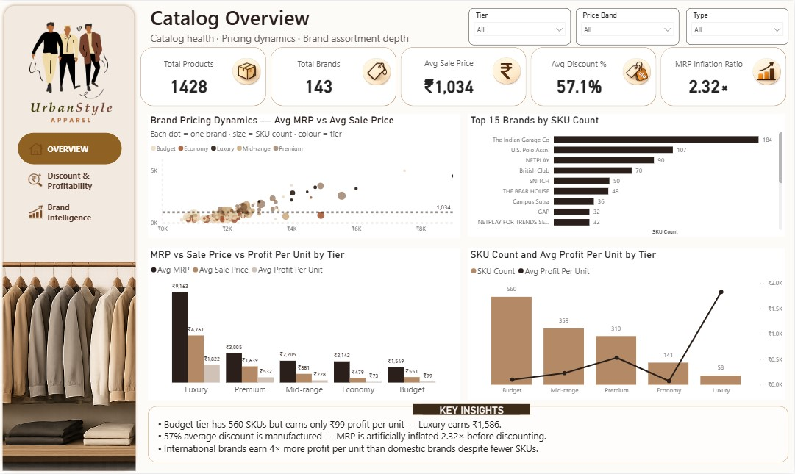
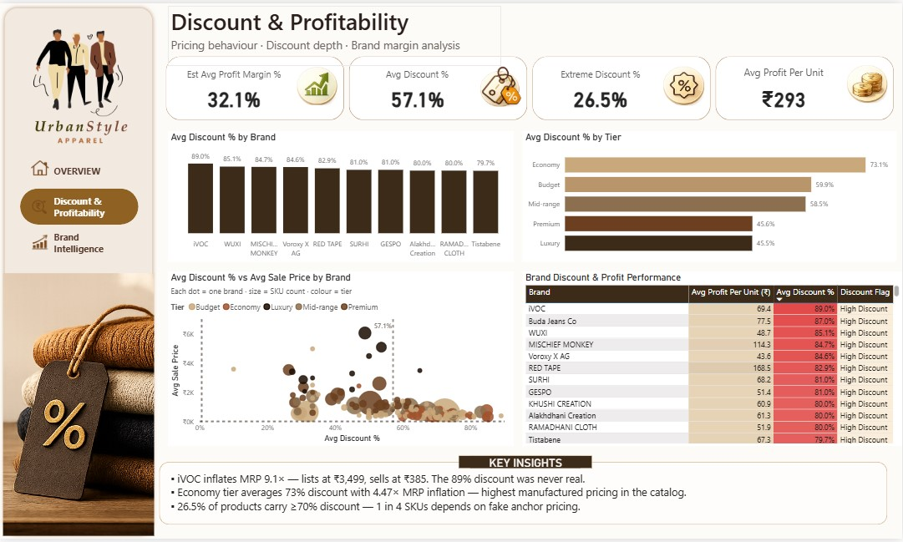
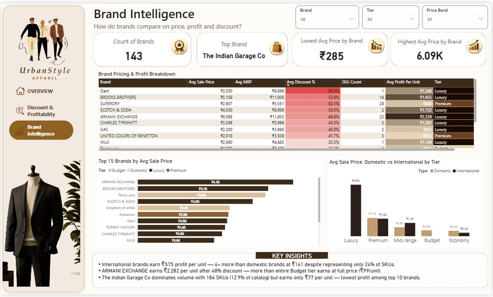

# T-Shirt Pricing & Catalog Intelligence Dashboard

**A Power BI project that checks if big discounts on men's t-shirts are real, and which brands and price groups really make money.**

| | |
|---|---|
| **Data** | 1,428 men's t-shirts from 143 brands (Indian online shop) |
| **Tools** | Power BI, DAX, Power Query, Excel |
| **Report** | 3 pages, 6 new columns, 12 DAX measures |
| **Live dashboard** | [ADD YOUR NOVYPRO LINK HERE] |
| **Full project document** | [Read the PDF](https://github.com/Tahseenahhamza/T-Shirt-Pricing-Catalog-Intelligence-Dashboard/blob/main/Tshirt%20pricing%20analysis%20documentation.pdf) |
| **All DAX formulas** | [Open dax_measures.md](https://github.com/Tahseenahhamza/T-Shirt-Pricing-Catalog-Intelligence-Dashboard/blob/main/dax_measures.md) |

---

## The Problem

Online shops show big discounts. But a discount is only real if the first price (MRP) is fair, and the shop still makes money at the selling price.

This project answers 5 simple questions:

1. How far is the MRP above the selling price?
2. Which price groups (tiers) make good profit? Which ones need big discounts?
3. How many products have a discount of 70% or more?
4. Which brands sell the most products? Do they also make the most profit?
5. Do international brands do better than Indian brands?

---

## Key Results

| What I measured | Result |
|---|---|
| Average discount | **57.1%** |
| MRP compared with selling price | **2.32 times** higher |
| Products with 70% or more discount | **26.5%** (about 1 in 4) |
| Average selling price | **₹1,034** |
| Estimated average profit margin | **26.3%** |
| Average profit per product | **₹243** |

**What the data shows**

- **Most products make very little profit.** Budget has 560 products (39% of all products) but makes only ₹99 profit on each. Luxury has only 58 products but makes ₹1,586 on each.
- **Economy tier needs the biggest discounts.** Its average discount is 73.1%, and it makes only ₹96 profit on each product.
- **International brands make about 4 times more profit.** They are only 16.5% of products, but make ₹575 on each. Indian brands make ₹141.
- **The biggest brand is not the best earner.** The Indian Garage Co has 184 products, but makes only ₹77 on each.

---

## Dashboard Pictures

### Page 1: Catalog Overview
Shows catalog size, average price, discount, brand prices and price groups.

### Page 2: Discount & Profitability
Shows how big the discounts are and if products still make profit.

### Page 3: Brand Intelligence
Compares brands on price, profit and discount. Also compares Indian and international brands.

---

## What I Suggest to the Business

1. Judge brands by selling price and profit, not by discount %.
2. Sell more Premium and international brands.
3. Check the Economy tier. Change prices, talk to suppliers, or remove weak products.
4. Remove low-profit products before adding new ones.
5. Check the MRP of every product that has a discount of 70% or more.

---

## How I Built It

1. **Data model:** Two tables joined on Brand (star schema).
   - `T-Shirt Products` (1,428 rows): Brand, Title, Sale Price, MRP, Cost Price
   - `Brand Tier Reference` (143 rows): Brand, Tier, Origin, Type (Domestic / International)
2. **New columns (6):** Profit Per Unit, Profit Margin %, Discount Amount, Discount %, Price Band, Discount Flag.
3. **DAX measures (12):** In 4 folders: Core Metrics, Discount Analysis, Profitability, Brand Intelligence.
4. **Checking my work:** I tested the measures with DAX queries and compared them with the charts. I found one mistake in the Domestic vs International chart (it showed MRP instead of Sale Price). I fixed it.
5. **Filters:** Tier, Price Band, Type and Brand. Click any chart to filter the rest of the page.

---

## Skills Shown

- Data modelling (star schema)
- DAX formulas and measures
- Power BI dashboard design
- Checking data and numbers
- Turning data into clear advice for a business

---

## Files in This Repository

| File | What it is |
|---|---|
| [T-Shirt Products Data.CSV](https://github.com/Tahseenahhamza/T-Shirt-Pricing-Catalog-Intelligence-Dashboard/blob/main/T-Shirt%20Products%20Data.CSV) | Product data |
| [Brand_tier_reference.xlsx](https://github.com/Tahseenahhamza/T-Shirt-Pricing-Catalog-Intelligence-Dashboard/blob/main/Brand_tier_reference.xlsx) | Brand tier and origin data |
| [dax_measures.md](https://github.com/Tahseenahhamza/T-Shirt-Pricing-Catalog-Intelligence-Dashboard/blob/main/dax_measures.md) | All DAX formulas |
| [Project document (PDF)](https://github.com/Tahseenahhamza/T-Shirt-Pricing-Catalog-Intelligence-Dashboard/blob/main/Tshirt%20pricing%20analysis%20documentation.pdf) | Full project document |
| Overview.jpg, Discount & Profitability.jpg, Brand Intelligence.jpg | Dashboard pictures |

---

## Limits of This Project

- The data is from one day (June 2026). It does not show changes over time.
- Profit numbers are estimates. They use the Cost Price column.
- A big gap between MRP and selling price means the MRP may be too high. It does not prove the MRP was never used.
- The data is from one website and has no sales numbers.

---

## About Me

**Tahseenah Hamza**, Data Analyst and Power BI Developer
[LinkedIn](https://linkedin.com/in/tahseenah-hamza) · [Portfolio](https://datascienceportfol.io/tahseenahhamza) · tahseenahhhamza@gmail.com
